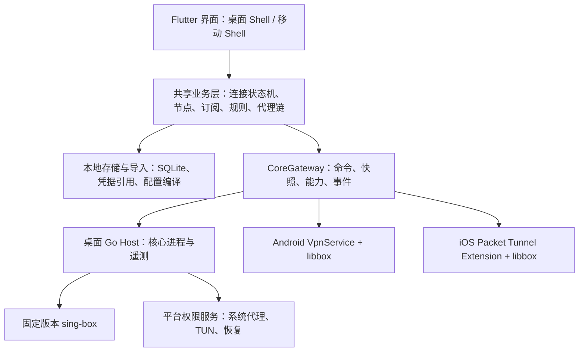

# RainLink 开发方案：桌面优先，覆盖五大平台

日期：2026-10-15。目标平台：Windows、macOS、Linux、Android、iOS。首期交付前三种桌面平台，移动端在桌面内测稳定后推进。

2026-10-20 安装取消续验：50 个取消边界和原有 30 次 SIGKILL 恢复通过；实际 systemd 下的五种写入后取消/提交保持场景，以及八种授权与管理回归通过。私有测试 checkpoint 的恢复证据与普通 broker 端到端取消范围分开记录，见[安装取消与恢复](verification/linux-install-cancellation.md)。接着补图形桌面、普通 broker 写入中取消和分发，公开 Linux TUN 保持关闭。

2026-10-20 等待认证取消：已修复并通过真实 pkexec/polkit 的 AUTH_ADMIN 取消、EOF 和代理拒绝，五种原有服务管理场景也通过回归。测试使用无密码的 D-Bus 协议代理，图形桌面认证及写入期间取消继续验收，见[认证取消记录](verification/linux-service-authentication-cancellation.md)。

**建议采用 Flutter / Dart 共享界面和业务层，sing-box 提供网络核心，平台适配层处理系统代理、TUN、隧道授权和分发。** 首期先完成真实连接与故障恢复，再逐步交付现有桌面 UI 的全部业务能力。

2026-10-20 服务管理续验：普通用户实际 pkexec 的管理、不同构建替换、授权后锁等待时取消和 EOF 已通过；Linux/macOS 接入共享安全退出并经组件验证。460 项 Flutter 与 40 张 fixture 通过，保存的 44 个 Figma SVG 与当前资产一致。下一步仍为活动桌面认证、事务写入期间取消、Linux GUI/分发及最新设计稿核对，公开 TUN 保持关闭，见[续验记录](verification/linux-tun-service-management-acceptance.md)。下文首次服务管理进展保留原检查点范围。

2026-10-20 进展：Linux GUI 权限服务管理已实现设置入口、独立管理协议和普通用户 `pkexec` 调用路径，自动化检查通过；真实管理 VM 的依赖下载失败，未完成该路径验收。后续优先补真实授权、取消/恢复和桌面视觉，再推进分发；公开 Linux TUN 仍关闭，见[服务管理阶段记录](verification/linux-tun-service-management.md)。以下记录为历史阶段快照。

2026-10-17 阶段收尾：按用户要求暂存开发进度并提交代码，完整目标未完成，见[检查点](verification/closeout-20261017.md)。最新 Linux 权限日志已复用原日志页面，15 个完整宿主场景通过；Linux 隔离网络 414 个、20 轮日志压力 500 个、真实 systemd / polkit 3 个、Windows 164 个 Go 通过事件分别记录。真实 VM 已验证核心启动、日志、YES / NO 授权及恢复，活动桌面认证弹窗仍待验收；公开 TUN 能力保持关闭，下一步为认证 / 取消和 GUI 服务管理。范围见[日志验收](verification/linux-tun-logs.md)。本阶段没有重新运行 Flutter 或全页面视觉核验。

2026-10-16 进展：Windows 八种协议（HTTP、SOCKS5、Shadowsocks、VLESS、VMess、Trojan、Hysteria2、TUIC v5）、认证安全保存、真实 sing-box 会话、系统代理、模式切换、出口探测及采样已接入；订阅 URL 导入、自动分组、手动 / 自动更新、流量和到期信息已接入。节点收藏、订阅本地别名、隐藏恢复与可取消的独立测速已实现；连接、日志、自定义规则与可视化代理链已有实际核心验收，正常与异常恢复已有实机验证。桌面 / 移动布局继续独立，共享业务层。当前 stdio 会话协议及尚未实现的范围见 [宿主接口](HOST_PROTOCOL.md)、[实现清单](IMPLEMENTATION_STATUS.md)、[节点管理验收](verification/node-management.md)、[八协议验收](verification/protocols.md) 和 [订阅验收](verification/windows-subscriptions.md)。以下表格保留完整产品目标，不表示所有功能已经完成。

流量续验：持久 15 分钟用量、日/周/月、保守归属排行及 CSV 已在 Windows 接入，切换页面继续采样；应用/规则多出站的精确归属仍未实现，见 [持久流量验收](verification/traffic.md)。

2026-10-17 订阅兼容续验：Clash、sing-box JSON 节点及 URI 参数按现有核心能力严格校验；不兼容项在原添加/详情弹窗逐项说明，确认后提交内存中的同一份预览。取消、预览失效与自动更新未确认均保留旧节点，远端 DNS/规则/监听配置不会直接应用。schema 7 保存安全兼容原因，两端流量详情不再用缺失值组成大号比值。下载器在已连接时使用当前本地代理，失败不自动回退直连；实际经 HY2 获取并解析了 68 个节点。真实 HY2 抽测、Figma 对照、回归及最新 0.1.0+4 预览见[订阅兼容验收](verification/subscription-compatibility.md)。

2026-10-17 Linux 基础阶段：新增 amd64 固定核心构建、Secret Service 主密钥及 AES-GCM 记录、取消/超时、私有会话与普通进程退出保护。在隔离的非 root Linux 中通过八协议、规则/链、配置、EOF 清理和真实密钥环锁定测试；该阶段共享 Flutter 404 项通过，系统接管尚未开放。

2026-10-17 Linux 安装续验：新增固定路径 root 安装器、升级、卸载及持久回滚。三十次真实进程强杀与安装 CLI fixture 通过；独立 Debian 13 / systemd 257 的实际安装、socket activation、idle/退出清理、重复升级、禁用状态保持、管理员覆盖项拒绝、资源租约拒绝替换及恢复卸载通过。网络/宿主 360 个、安装 fixture 95 个、真实 systemd 一个、Windows 164 个 Go 通过事件，见[安装验收](verification/linux-tun-install.md)。真实桌面授权弹窗、权限日志、GUI 管理和正式分发仍待推进，公开 Linux TUN 保持关闭。

2026-10-17 Linux TUN 前阶段续验：普通 Manager 已接入真实密钥环、节点/链/规则、连接、遥测、模式与恢复确认，14 个完整宿主场景通过。当前共 359 个 Linux 网络/恢复/IPC、164 个 Windows Go 通过事件，Flutter 440 项与静态检查通过，见[宿主接入验收](verification/linux-tun-manager.md)。真实 polkit / systemd、权限日志与安装管理仍待完成，公开开关保持关闭；权限路径需 Linux 6.5+，旧内核替代尚未实现。前阶段[实际转发](verification/linux-tun-forwarding.md)、[权限通信](verification/linux-tun-permission.md)、[独立监控](verification/linux-tun-watchdog.md)、[托管核心](verification/linux-managed-tun-core.md)与[资源恢复](verification/linux-tun-recovery.md)保留历史快照。完整 GNOME/KDE 244 个事件本轮未整套重跑，仅新增验证 GNOME 与 TUN 共存。

2026-10-17 KDE 续验：新增 Qt / KConfig6 配置辅助程序，统一 GNOME / KDE 的用户租约并保留旧版日志恢复。独立 libproxy 解析、KConfig 变更通知、认证 / PAC / 未设置项 / 系统默认、真实核心传输，以及两套后端的正常退出、强杀宿主 / 核心和 watcher 重启通过。Linux 242 个 Go 通过事件、Windows 162 个回归事件、8 项 Flutter 状态协议测试及静态分析通过。尚未验收真实 Plasma / GNOME GUI、KDE5、Linux TUN、桌面集成和分发，见 [KDE 验收](verification/linux-kde-proxy.md)。

2026-10-17 GNOME 阶段：接入环境检测、首页系统代理开关、加密恢复租约及 pidfd watcher，保留原代理认证、绕过列表、未设置项目及无关配置。该轮 Linux 222 个 Go 通过事件、Windows 162 个通过事件、405 项 Flutter 回归及静态检查通过；当时 KDE 尚未接入。历史范围见 [Linux 宿主验收](verification/linux-session.md)。

设置续验：双端六分类已接入真实主题、字号、减少动效、网络与核心设置。DNS/引导解析、本地端口和日志级别先通过独立核心校验再保存；下一次连接或确认重启应用，重启保留原活动目标及规则快照。2026-10-17 续验新增 Windows 托盘、当前用户开机启动、启动自动连接和连接通知；隐藏窗口后真实传输、原生恢复及启动注册表写入/回读/恢复通过。真正退出先确认网络恢复并等待偏好写入；恢复失败保留窗口。真实 DNS 与 Windows 会话隔离验证见 [设置验收](verification/settings.md)。界面密度及双端相关列表已完成并验收，见 [密度验收](verification/density.md)；订阅到期提醒已完成本机 Windows 续验，见 [到期提醒验收](verification/subscription-expiry.md)。

2026-10-17 应用更新续验：Windows 固定 GitHub 发布源、渠道、下载取消/摘要校验、确认安装、网络恢复与后台任务退出交接、候选首帧确认和程序/SQLite 回滚已实现。0.1.0+3 新增独立启动器、持久事务日志和强杀 helper 后的自动恢复，提交以后不降级数据库；旧布局迁移及启动器改变需完整手动升级。332 项 Flutter、79 个 Go 通过测试事件、5 项 Python 打包回归及真实 AOT 三场景通过；56 张历史更新布局 fixture 保留。见 [应用更新验收](verification/app-updates.md)与[中断恢复验收](verification/app-update-recovery.md)。当前生产源尚无可用发布版本；正式发布、签名、卸载、物理断电及其他平台服务继续列为后续范围。

2026-10-17 高级配置续验：核心引擎内新增受控 YAML/JSON 片段编辑、独立核心校验、确认应用、上一版恢复与导出。DNS、日志和补充分流有明确字段归属；在线应用保留实际活动目标/模式/接管，失败恢复原连接，用户取消不会复活会话。片段与历史同一事务保存，完整范围见 [高级配置验收](verification/advanced-config.md)。

2026-10-17 TUN 续验：Windows 独立权限进程、固定校验核心、单核心双接管、概览真实开关、原活动目标重连及失败回退已接入。TCP/UDP/DNS 和正常/异常退出恢复已有本机证据；标准用户 UAC、IPv6 公网及安装服务尚待验收，见 [TUN 验收](verification/tun.md)。

## 1. 设计读取结果与范围

2026-10-17 Android 续验：已接入嵌入式 libbox、Keystore、前台网络服务、双栈 TUN、protect/bind、DNS 测试、原会话恢复及原快照重连。修复空高级配置恢复误判、cgo 回调帧对齐引起的低内存崩溃，以及启动失败后的重复关闭误判；连接成功还须确认系统已登记实际 TUN。实时连接、关闭确认、脱敏日志和持久采集已接入；系统文件保存的实际字节、取消和页面关闭已有验证。通用设置接入默认关闭的启动自动连接、连接状态通知与订阅到期提醒，见[自动连接与提醒](verification/android-startup-notifications.md)。新增[配置与切网验收](verification/android-configuration.md)：移动可视化双跳、概览连接、反向链、三模式、在线配置拒绝与恢复、失败回退及同一系统隧道的 Wi-Fi/蜂窝/断网恢复通过。共享回归 403 项 Flutter、5 项 Kotlin 单元测试，10 项原生测试按五个进程验收；五个主页面及连接、日志、通用设置的深浅主题共 16 张 Android 渲染 fixture。44 个 SVG 与已保存的 Figma 原生导出一致，完整 APK 原生库及 ZIP 16 KB 对齐通过。此前软件渲染模拟器的卡顿记录保留；本轮宿主 GPU 的普通 Debug 冷启动回执为 4,583 ms，不代表正式性能。真机、真实授权对话框、远程协议、其余完整业务流程和长期生命周期压力继续验收。详见 [Android 验收](verification/android.md)及[Android 遥测验收](verification/android-telemetry.md)。

本方案通过 Figma Bridge 实时读取 RainLink 的三个页签，查看 23 个主要产品画面及弹窗的原生截图，读取 66 组组件的 549 个变体，并核对当前业务交互和平台交付约定。另导出浅色窄桌面、小屏手机、大字 IPv6、键盘弹窗四个边界示例。

| 设计范围 | 已读取内容 | 实现阶段 |
| --- | --- | --- |
| 桌面 8 个一级页面 | 概览、节点、分组、规则、连接、流量、日志、设置 | 首期全部覆盖 |
| 桌面 1 个辅助页面 | 代理链编排 | 首期覆盖 |
| 桌面 3 个弹窗 | 添加订阅/节点、移动节点、订阅详情 | 首期覆盖 |
| 移动 5 个一级页面 | 首页、节点、分组、流量、设置 | 第二期 |
| 移动 3 个辅助页面 | 快速选择、DNS、代理链 | 第二期 |
| 移动 3 个弹窗 | 添加、移动节点、订阅详情 | 第二期 |
| 设计系统 | 颜色、字体、间距、状态、平台行为、响应式和辅助功能 | 两期共用 |

本方案形成时，项目主要由设计规范、Figma 插件源码和导出资产组成。现已建立 `app/` 客户端与 `native/host/` 基础工程，当前实现范围与运行方式见根目录 [README](../README.md)。`design/reference/figma-mcp-bridge` 是设计工具参考代码。

设计依据优先级：本次实时产品画面及最新交付约定 → `DESIGN.md` → 当前设计 README → 历史评估。历史评估里已经修复的问题不作为当前缺陷重复处理。Bridge 当前文件标识为本地未保存标识，云端修订号未确认；本方案保留截图和节点 ID 作为实现基准。

- [逐页功能与组件清单](plan/UI_INVENTORY.md)
- [实时页面、文案与截图索引](plan/ui-inventory.json)
- [组件及变体清单](plan/component-states.json)
- [可映射到 Flutter 的设计 Token](plan/design-tokens.json)
- [本次读取与原型扫描记录](plan/figma-read-evidence.json)

## 2. 技术选择

| 层次 | 建议方案 | 原因与约束 |
| --- | --- | --- |
| 跨平台应用 | Flutter 稳定版、Dart | 五个平台共用组件和业务模型；桌面表格与移动卡片分别布局 |
| 状态管理 | Riverpod，业务命令通过 Controller 执行 | 全局连接状态统一，页面按字段订阅，避免实时流量触发整页重建 |
| 导航 | go_router、桌面 Shell、移动 Tab Shell | 桌面八导航、移动五 Tab；详情路由保留来源和返回位置 |
| 本地数据 | SQLite，使用 Drift 管理查询和迁移 | 保存订阅、节点、分组、规则、覆盖属性、偏好和统计汇总 |
| 密钥存储 | 平台安全存储适配器 | Windows 用户凭据保护、Apple Keychain、Linux Secret Service、Android Keystore；Linux 无密钥服务时明确降级行为 |
| 网络核心 | 固定版本 sing-box | 与设计中的核心选择一致，协议、DNS、路由和代理链集中实现 |
| 桌面核心宿主 | 小型 Go Host + 随应用分发的 sing-box 可执行文件 | 管理核心进程、校验、事件、临时探测和平台权限；普通 UI 保持用户权限 |
| 桌面通信 | Windows Named Pipe；macOS/Linux Unix Domain Socket | 版本化命令、快照和事件；校验当前用户、会话及消息大小 |
| 移动核心 | Android / Apple 原生服务嵌入 libbox，使用平台桥接 | 移动隧道独立于 Flutter 页面生命周期；不依赖启动桌面子进程 |
| 原生桥接 | Pigeon / 平台插件；不适用时采用薄原生通道 | Kotlin、Swift 负责移动系统服务，桌面壳处理托盘、窗口和通知 |
| 图表 | fl_chart + 自定义 Tooltip / Painter | 保持 Figma 的紧凑刻度、双折线和薄荷色；版本在 M0 验证 |
| 质量验证 | Flutter 单元/组件/集成测试、Go 测试、三平台真机检查 | 分别证明业务规则、界面行为和真实系统接管 |

Flutter、Go、依赖及核心版本在 M0 选择、固定并提交锁文件。Figma 中的 `1.0.0`、`sing-box 1.12.0` 是显示示例，运行时显示实际构建与核心版本。

本地优先：首期不引入账户、云同步、服务端订阅转换或远程控制。订阅和节点解析在本机完成；必要请求包括订阅更新、DNS、健康探测、出口检测和应用更新。

## 3. 架构与职责



业务层只认识领域模型和 `CoreGateway`。桌面 Host、Android 服务和 iOS 扩展实现同一份逻辑契约，系统能力通过 `PlatformCapabilities` 返回。界面根据可用能力、原因和当前授权展示控件。

桌面先采用随应用打包的核心进程。Host 作为控制入口；权限服务仅负责允许的网络接管操作及必要的核心生命周期，不提供任意命令执行。TUN 启用时，保证单一核心拥有会话，用户模式与权限模式的切换须停妥旧实例、交接监听端口和事件流，避免同时运行两个活动核心。

核心遥测可先通过本地 Clash API 适配，日志通过结构化事件/输出采集。API 仅监听回环地址，使用每次会话生成的认证值。公开文档没有保证每项客户端工具所需的字段和控制语义；M0 必须实际验证连接关闭、进程归属、速率、日志和模式切换，缺失能力由 Host/libbox 补齐或向 UI 返回不可用。

模式不能只修改 Clash API 的 `default_mode`：配置编译器必须生成相应的 `clash_mode` 路由及 DNS 行为，并验证规则、全局、直连三条路径。

目标目录如下；基础工程已建立，未实现的业务目录将随功能开发添加：

```text
app/
  lib/
    app/                  # 启动、路由、依赖注入
    design_system/        # Token、字体、基础控件和自适应壳
    features/             # overview/nodes/groups/rules/connections/traffic/logs/settings/chain
    domain/               # 模型、状态机、业务命令、配置编译
    data/                 # SQLite、订阅解析、凭据适配、导出
    platform/             # CoreGateway、DesktopHostClient、移动桥接
  test/
  integration_test/
  windows/ macos/ linux/ android/ ios/
native/host/
  cmd/rainlink-host/
  internal/               # 协议、核心管理、遥测、权限服务
  platform/               # Windows、macOS、Linux 实现
fixtures/                 # 文档地址与无真实凭据的订阅/协议样本
docs/                     # 方案、接口、验收、设计证据
```

## 4. 桌面首期功能拆分

| 页面/流程 | 真实业务实现 | 完成标准 |
| --- | --- | --- |
| 概览 | 连接、取消、断开；规则/全局/直连；系统代理/TUN；出口；速度、流量、延迟与健康 | 操作以核心和系统回执为准；错误可恢复；改选显示待应用 |
| 节点 | 全分组搜索、组内浏览、选择、收藏、测速、来源菜单 | 任意文本即时筛选；清空保留选择；操作权限按节点来源控制 |
| 分组 | 订阅自动成组、组选择、每组记忆、手动节点归组 | 组列表不重复节点详情；订阅更新保留手动节点和本地覆盖 |
| 添加 | 订阅链接、8 种协议表单、校验、取消、失败重试 | 成功事务入库；错误定位字段；不启动连接 |
| 订阅详情 | 用量/到期、更新、修改 URL、删除 | 缺失值显示未提供；失败保留最近可用数据 |
| 规则 | 域名、IP、兜底规则；添加、编辑、删除、优先级 | 从上到下匹配；检查 CIDR/域名、无效目标和兜底位置；失败回滚 |
| 实时连接 | 搜索、代理/直连筛选、暂停视图、关闭单条/全部、导出 | 暂停只冻结视图；关闭以连接 ID 和核心回执确认；实际生成文件 |
| 流量 | 今日/本周/本月、双向曲线、汇总、可归属排行、CSV | 核心重启、跨日和休眠后不重复累计；导出与屏幕范围一致 |
| 日志 | 等级、搜索、暂停视图、清空确认、滚动、导出 | 有容量上限和保留期限；认证信息、订阅令牌和 URL 密钥被遮蔽 |
| 设置 | 六分类、主题/语言/密度、大字、DNS、端口、核心、高级配置、更新/关于 | 偏好持久化；网络配置校验后应用；真实版本和分发渠道可识别 |
| 代理链 | 添加/更换/排序/移除跳点、测试、保存并选中 | 按真实顺序转发；报告失败跳点；保存不改变当前活动连接 |

八种手动节点协议为 Shadowsocks、VLESS、VMess、Trojan、Hysteria 2、TUIC、SOCKS5、HTTP。Figma 列表中的 Hysteria 标签在添加表单里明确为 Hysteria 2；产品数据模型必须区分版本。旧 Hysteria 1 如需导入，应单独声明支持与测试，不能按 Hysteria 2 解释。

协议表单采用各自的字段模型、校验和高级区。UUID、密码、加密方式、TLS/SNI、Reality、传输与 WebSocket 路径等按实际协议能力出现。Shadowsocks 不直接套用通用 TLS 字段；插件、传输和指纹参数仅在锁定核心确实支持时展示。

## 5. 全局状态与连接流程

### 5.1 区分选择、实际配置与视图

```text
selectedTarget              当前想使用的节点/组/链，持久化
lastSelectedNodeByGroup     每组上次选择的节点，持久化
activeConfigSnapshot        本次实际应用的完整配置及节点快照，由 Host 持有
activeOutbound              当前应用的默认代理目标，包含真实节点/链快照
pendingApply                所选有效目标与当前活动快照不一致，由状态推导
connectionState             idle / authorizing / starting / connected / stopping / failed
desiredCaptureSettings      用户期望的系统代理和 TUN 选项
observedCaptureState        系统实际生效、失败或需恢复的接管状态
egressResult                当前路径的检测状态、IP、国家、时间和请求代次
```

分组浏览、搜索查询、弹窗草稿、表格排序和暂停视图属于页面状态，不与实际连接目标混存。点击组卡片选择该组；右侧入口进入节点；没有记忆节点时选第一个可用节点，空组保留选择并禁用连接。

规则模式可能同时使用多个出站。`activeOutbound` 表示默认代理目标，每条连接另有自己的匹配规则和实际出站。所有组的活动节点选择随连接配置一起冻结；在节点页改选不会向正在使用的 Selector 发切换命令。

订阅更新、编辑或删除节点不重建当前活动配置。当前会话保留可用快照；若所选目标失效，清除无效选择、提示重新选择，断开后不能重新使用已删除目标。

### 5.2 连接事务

1. 验证目标、协议能力、规则引用、凭据、端口和配置；生成不可变配置快照。
2. 申请当前需要的权限。拒绝时返回明确错误并保留选择。
3. 保存当前系统代理/路由等恢复信息；启动核心并检查本地监听与控制通道就绪。
4. 按用户选项启用系统代理/TUN，检查系统回读；全部必要步骤成功后才显示已连接。
5. 若中途取消、失败或超时，停止本次操作，恢复本次已经改变的系统状态并报告结果。
6. 断开时先停止新流量接管，再关闭核心并清理本次资源；恢复失败显示明确的恢复状态和重试入口。

连接和断开命令串行化，使用 `operationId`、会话 ID、递增事件序号。取消后迟到的成功事件不能把界面改回已连接。重复点击和重复系统回调须幂等处理。

已连接时改选：更新 `selectedTarget` → 显示待应用 → 用户在概览断开并重新连接 → 采用新快照。保存代理链同样遵守此流程。模式在概览切换，需由核心确认生效，失败恢复原模式。

### 5.3 系统代理与 TUN

两个桌面开关独立保存。核心可在二者均关闭时运行，只供手动代理应用使用；概览辅助信息说明当前接管范围。直连模式决定流量路由，独立于接管方式。

每次系统代理修改先记录原值，退出时仅恢复仍由 RainLink 占用的值，避免覆盖用户或其他软件后续修改。Windows 首期管理当前用户 Internet Settings 代理并发送设置变更通知，WinHTTP 和应用自带代理不自动等同于该范围；macOS 按实际网络服务保存与恢复，Linux 按已验证桌面环境处理。系统代理覆盖遵循该设置的应用，TUN 的接管范围单独说明。核心自身、订阅获取和必要控制请求须有明确的绕行路径，避免 TUN 递归。

窗口关闭默认最小化到托盘。真正退出要按用户设置停止接管并恢复系统；不默认遗留后台网络配置。核心崩溃由 Host/权限服务执行恢复，不能只依靠 Flutter 的退出回调。休眠、唤醒、Wi-Fi/有线切换和系统外部断开后重新核对实际状态。

## 6. 数据、订阅与核心接口

### 6.1 最小数据模型

| 模型 | 主要字段/约束 |
| --- | --- |
| Subscription | id、URL 凭据引用、服务名称、更新时间、自动更新策略、ETag、套餐可空值 |
| Group | id、类型、subscriptionId、排序；订阅与自动分组对应 |
| Node | id、协议及版本、服务器、端口、认证引用、TLS/传输配置、来源、当前所属组 |
| NodeOverride | 订阅节点稳定标识、别名、收藏、隐藏；与服务参数分开保存 |
| ProxyChain / Hop | 名称、有序节点引用、修订号、最后测试结果及配置摘要 |
| RouteRule | 类型、匹配值、出站目标、优先级、启用状态；兜底只保留有效终点 |
| Preferences | 主题、语言、密度、大字、窗口行为、DNS、监听与更新偏好 |
| ConnectionSnapshot | 会话 ID、配置摘要、冻结目标/规则；敏感部分只在受控运行时区域 |
| TrafficBucket | 时间段、方向、出站/进程可选维度、字节数、核心会话及计数器代次 |

订阅节点以服务提供的稳定 ID 为首选；没有 ID 时使用规范化连接特征生成本地稳定标识。名称、排序、流量和测试延迟不参与身份判断。凭据变更与节点重建需要明确匹配策略并测试，避免收藏丢失或旧隐藏状态误用到新节点。

手动节点默认进入未分组，仅此时显示移动入口。移入订阅组仍保持手动来源；订阅更新仅替换该订阅拥有的节点，删除订阅时手动节点退回未分组。

### 6.2 订阅导入与更新

支持范围明确分层：单节点 URI、URI 列表/Base64、Clash 类 YAML 的节点子集、sing-box JSON 的受支持 outbound 子集。订阅中的规则、脚本、provider 和未支持参数不能静默忽略；显示可导入数量和不支持原因。完整高级配置另走配置编辑流程。

获取 → 识别格式 → 解析到领域模型 → 协议与字段校验 → 检查差异 → 数据库事务替换。超时、空响应和全量校验失败保留上次可用数据。部分不兼容结果需展示明细并让用户决定是否导入可用部分。

名称优先服务返回名称，其次域名，最后自动编号。套餐数据采用服务返回的 usage/expiry 信息，上传、下载、总额度、到期分别可空；未提供与数值零严格区分。自动更新受应用/系统后台调度约束；设备离线或应用未运行时，恢复后执行到期检查，不承诺跨平台精确每六小时唤醒。

### 6.3 CoreGateway 逻辑契约

| 命令/事件 | 说明 |
| --- | --- |
| getCapabilities / getSnapshot | 返回实际平台能力、核心版本、权限、当前会话和接管状态 |
| validateConfig | 对最终生成配置执行核心版本对应的校验，返回字段路径/行列/不支持项 |
| start / cancelStart / stop | 带操作 ID 的幂等会话操作，不能由页面自己启动进程 |
| applyMode / applyNetworkConfig | 明确是否影响现有连接，校验和应用为事务；失败恢复旧配置 |
| probeNodes / probeChain | 可取消、有限并发的临时测试，测试当前配置摘要对应的真实路径 |
| listConnections / closeConnections | 按核心连接 ID 操作；导出和关闭范围明确 |
| streamEvents | 状态、权限、错误、速率、连接、日志、健康结果；含会话 ID 和序号 |

Host 的私有 IPC 和核心的本地控制端口分开。业务层不暴露原始控制 API。UI 重开后先取快照再订阅事件；Host 重启后旧会话事件失效。

高级配置默认使用受控覆盖模式：YAML/JSON → 结构模型 → 与生成配置合并 → 核心校验 → 确认应用。路由、DNS、监听和认证字段有清晰归属；界面无法管理的字段显示来源。提供上次有效配置回滚，避免 UI 表单与原始配置互相覆盖。

## 7. 代理链、出口与统计的实现细节

### 7.1 代理链

`本机 → A → B → 目标` 对应最终选择 B，B 的 `detour` 指向 A；更多跳点依次向前引用。两跳以上逐级生成独立标签，检查重复、循环、缺失引用和协议组合。

HTTP 跳点只能建立 TCP 隧道，因此不能直接承载后续 Hysteria 2 / TUIC 的原生 UDP/QUIC 拨号。可在 TCP 承载 UDP 的其他组合仍须逐项测试。不能把所有协议排列都视为支持。

测试结果分别记录 TCP、UDP、DNS、真实出口、耗时和失败跳点；一部分成功不能显示全链路通过。测试使用隔离上下文，不切换用户活动出站。跳点或参数修改后，原测试结果标为过期。保存经结构/能力校验，并保留清楚的测试状态。

### 7.2 公网出口

IP 与国家来自同一次请求结果，按返回 ISO 代码选国旗。未连接走直连；已连接按当前模式和活动配置走实际检测路径。规则模式的检测请求必须经过正常规则求值，并标明它代表检测请求的出口；不能强制走默认节点后冒称规则出口。

连接、模式或活动出站变化后清空旧结果、递增检测代次，再发请求；迟到的旧结果丢弃。仅改选待应用目标不刷新。失败显示未获取；只有 IP 时保留 IP，国家使用地球图标。检测服务适配可替换，超时和重试有上限。

节点名称里的国家只用于列表标签，与实测出口国家分开。设计中的 `203.0.113.24` 等文档地址仅保留在测试样本。

### 7.3 流量、延迟和日志

实时指标默认 1 秒采样，离开页面可降低 UI 刷新频率；Host 持续采集。以核心会话和计数器代次识别重启，用差值累计字节；持久化聚合和检查点在同一事务中提交。系统代理与 TUN 共用一份核心计数，避免重复累计。

原始字节是事实来源；显示 MB/GB 采用统一单位规则，日期按运行设备当地时区划分。今日用速率 MB/s，周/月按日累计 GB；Tooltip 和 CSV 标明单位、时区与时间范围。历史排行只有持续采集的归属数据才展示，不从当前连接反推历史。

延迟说明采用 TCP/HTTP/其他实际探测方法；不以 TCP 成功次数冒充网络丢包率。设计中的“98/100”“丢包 0%”没有给出计算规则，首版仅显示可解释的延迟、抖动和探测成功率；质量分数在定义并验证算法后启用。

日志保留期初始为 7 天，并设置总容量上限；内存只保留有限滚动窗口，持续收集与暂停视图分开。日志写入和导出前统一处理密码、UUID、认证 Header、订阅 URL 令牌和查询参数。导出的 CSV 对公式前缀做安全编码，使用系统文件选择/分享流程，并返回实际写入结果。

## 8. 五个平台的交付边界

以下系统版本是建议的产品测试基线，须在 M0 以锁定 Flutter/核心版本核对。首期体系结构覆盖三桌面平台；CPU 架构按实际构建和验收列表逐项发布。

| 平台 | 建议首批目标 | 接管与集成 | 分发 |
| --- | --- | --- | --- |
| Windows | Windows 11 x64 为主，Windows 10 22H2 x64 作兼容测试 | 用户系统代理；受控权限服务运行 TUN 核心、管理适配器和恢复；托盘与开机启动 | 签名安装包；卸载清理服务和本程序资源 |
| macOS | macOS 13+；Apple Silicon / Intel 分别构建验证 | 系统网络服务代理；签名权限 Helper 管理 TUN；菜单栏与睡眠恢复 | 首发公证 DMG；App Store 沙箱渠道另行适配 |
| Linux | Ubuntu 22.04/24.04 x64 为首批；GNOME，明确验证 KDE 范围 | `/dev/net/tun`、必要 capabilities / polkit / 服务；GNOME/KDE 代理分别实现 | deb / AppImage；显示权限服务安装状态 |
| Android | 第二期，建议 Android 10+；arm64 优先 | Kotlin VpnService、授权、前台服务、protect/bind、网络切换和 libbox | 商店与独立 APK 按安装来源处理更新 |
| iOS | 第二期，建议 iOS 15+ | Swift Packet Tunnel Extension、App Groups、共享凭据与配置、libbox | App Store/TestFlight；真机、签名与扩展 entitlement 单独验收 |

Linux 没有覆盖所有桌面环境的单一系统代理开关。识别环境后提供已验证的实现；未知环境说明可用的手动代理/TUN 路径。Wayland、托盘缺失和无 Secret Service 的桌面也需要可恢复的产品行为。

进程名/应用排行通过能力表按场景启用：桌面核心拿不到进程归属时标记未知；Android 需验证 UID 归属及限制；普通 iOS Packet Tunnel 不据此承诺其他应用的完整流量排行。无可靠归属时切换为节点/出站排行，保留统计卡片结构。

Windows ARM64、Linux ARM64 和更多发行版列入扩展矩阵；五平台支持不自动代表全部 CPU 和发行版已验证。macOS/iOS 构建、签名和真机验证需要 Mac，Linux 需要对应桌面环境，Windows 本机测试不能代替。

## 9. 设计落地规则

主题使用语义 Token，保留中性深色、薄荷主色和细边框。两套颜色变量归并为深浅主题；Figma 的节点 ID 不进入业务逻辑。图标、品牌及国旗导出矢量并带许可清单；表格和图表用组件绘制。

实时基准为桌面 1440×900、移动 393×852。标准桌面侧栏 248，1100–1439 宽度使用 216，低于 1100 切为图标导航；内容保持弹性列和局部滚动。此规则统一了标准画面与 1100 浅色验收稿的不同侧栏宽度。窗口拖动不能把页面整体等比缩小。

页面标题按实际产品的 26/36，而非遗留 Text Style 的 28；正文 14、辅助 12。中文思源黑体/Noto Sans SC，拉丁数字 Inter，IP/代码 Roboto Mono；字体按语言回退并保留许可，避免整包无差别嵌入过大字体。

节点行 56、分组行 72，列头和内容共同约束列宽；卡片圆角 12、控件圆角 8。移动点击区至少 44，辅助文字至少 12，大字模式允许卡片增长。Figma 名为“透明”的遗留颜色变量实际 alpha 为 1，实现时映射为真正透明语义，保留原始读取说明。

桌面键盘支持 Tab/Shift+Tab、Enter、Esc、上下选择、Ctrl/Cmd+K 命令入口及 1–8 导航；快捷键按平台显示。实现可见焦点、屏幕阅读标签、状态文本和减少动效。交互信息不能只靠颜色。

## 10. 实施里程碑

以一名全职工程师、三平台设备/构建环境和测试节点齐备估算。下表为工程工作量区间，阶段退出以验收结果为准；签名账号、分发审批和外部依赖等待另计。

| 阶段 | 工作量 | 交付内容 | 退出条件 |
| --- | --- | --- | --- |
| M0：架构验证 | 3–5 工作日 | Flutter 三桌面启动；CoreGateway 最小协议；核心版本/许可；三平台核心和接管探针 | 每个平台完成连接、拒绝权限、断开、核心异常后的恢复记录；核心 API 缺口有明确处理路径 |
| M1：设计系统与桌面壳 | 5–7 工作日 | Token、深浅主题、八导航、状态栏、表格/弹窗、响应式和快捷键 | 1440/1100/窄窗截图复核；测试数据通过隔离数据源注入，运行态不会默认显示示例网络值 |
| M2：节点与订阅 | 7–10 工作日 | 数据库、八协议、订阅解析/更新、分组、收藏/隐藏/移动、搜索、测速 | 导入—选择—重启恢复闭环；更新失败和删除语义通过；协议测试覆盖已声明参数 |
| M3：桌面真实网络闭环 | 8–12 工作日 | 连接状态机、系统代理、TUN、模式、规则、DNS、出口和回滚 | 三平台浏览器/命令行真实流量验证；选中/活动状态分离；断网、切网、唤醒与权限异常通过 |
| M4：诊断与代理链 | 7–10 工作日 | 连接控制、持久流量、日志、CSV/日志导出、代理链编排/真实测试 | 关闭与导出产生实际结果；统计不重复；链路顺序、能力和失败定位均验证 |
| M5：桌面内测与发布准备 | 5–8 工作日 | 性能、长时运行、安装/卸载、托盘/自启、更新验证、三平台打包 | 验收清单无阻断项；产物含版本/签名/校验；安装到真实系统后的恢复行为通过 |

合计约 35–52 工程工作日，连同联调和修正预留约 **9–13 周达到桌面可用内测**。如果 M0 暴露核心遥测或 macOS/Linux 权限服务缺口，应按验证结果重排后续时间，不用界面完成度抵消系统功能缺失。

桌面稳定后，Android 约 3–5 周、iOS 约 4–6 周作为第二期估算起点。复用主题、业务模型、订阅、规则、代理链与状态机；移动页面布局、授权、后台生命周期和更新渠道独立验收。iOS 扩展在 UI 进入完整开发前先做真机连接验证。

## 11. 验收与交付标准

### 11.1 核心用例

| 用例 | 必须观察到的结果 |
| --- | --- |
| 首次启动，无节点 | 空状态和添加入口；连接不可用；没有示例 IP、速度或在线节点 |
| 正在连接时取消/连续点击 | 核心最终停止；无迟到成功；系统配置恢复；按钮恢复可操作 |
| A 已连接，选择 B | A 继续处理新连接，显示 B 待应用；重新连接后才使用 B |
| 更新/删除正在使用的订阅 | 活动快照继续；手动节点保留或退回；断开后失效目标不能重连 |
| 权限拒绝/端口冲突/配置错误 | 错误指出原因；原选择保留；无残留接管；可重试 |
| 系统代理/TUN 四种组合 | 接管状态与系统回读一致；核心流量不递归、不重复累计 |
| 核心崩溃、UI 崩溃、真实退出 | 权限服务完成清理；原代理设置恢复或显示具体恢复失败项 |
| 休眠唤醒、断网和换网络 | 当前状态重新核对，必要重连；旧请求与旧出口结果不覆盖新状态 |
| 规则/全局/直连 | 对指定域名和 IP 的可观测出站符合模式与规则，不只检查 API 字段 |
| 多跳和不兼容链路 | 通过独立端点/服务日志确认顺序；HTTP→QUIC 等不支持组合清楚失败 |
| 核心重启、跨日、时区改变 | 流量有明确边界；零/缺失分开；不重复累计，不产生负速率 |
| 导出与高级配置回滚 | 文件真实存在、内容正确且脱敏；错误配置不会破坏上次可用连接 |

### 11.2 测试层次

单元测试覆盖状态机竞态、订阅差异更新、来源权限、搜索语义、配置编译、代理链方向、流量计数和脱敏。组件/集成测试覆盖关键用户流程及深浅主题；系统代理、路由、服务、签名安装与真实流量在三种桌面系统分别验证。

协议测试使用可控服务端和独立端点观测；本地样本证明解析与配置，核心真实握手证明协议路径，外部访问证明系统接管。三种证据分别记录，不互相替代。

建议性能验收数据集：1 万节点、5000 活跃连接、1 万可见日志记录的滚动/筛选，运行中保持受控内存和日志容量。以指定设备 profile/release 测量，目标 60 Hz 下无持续掉帧；这些是待测目标，不是当前结果。

发布构建在对应平台安装测试。更新包校验签名/摘要，失败可回到上一版本；核心和配置 schema 同步版本化，升级前备份数据并验证数据库迁移。保留便于复现且已脱敏的诊断包。

## 12. 开发前需要在 M0 收敛的事项

1. 选定实际核心稳定版本、构建选项和完整支持矩阵；确认 Clash API/libbox 所需能力。核心升级先过回归，再修改锁定版本。
2. 核验所选 sing-box 源码及其实际 LICENSE、组合方式和分发要求。已读取的官方主页声明 GPL 第 3 版或后续版本，与设计许可页一致；应用最终许可与源码交付方案应与锁定源码及附加条款相容。本方案不代替发布许可决策。
3. 在 macOS、Linux 上实测权限服务、系统代理范围、进程归属和退出恢复。通过后再对外声明该能力可用。
4. 固定规则模式下的真实配置模板、DNS 默认/备用策略、出口检测服务及超时策略。
5. 把“网络质量分数”和无归属的“应用排行”调整为可测、有来源的数据表示；此处属于对设计示例的运行时收敛。

Windows 已完成的阶段以 [实现清单](IMPLEMENTATION_STATUS.md) 和各项验收为准；订阅到期提醒已接入，见 [到期提醒验收](verification/subscription-expiry.md)。后续继续在线更新、分发及其余平台的连接与恢复验证。桌面版本逐阶段交付，Android/iOS 继续使用相同业务契约。

## 13. 参考与证据

产品行为以 [DESIGN.md](../DESIGN.md)、[当前设计说明](../design/README.md)、实时 Figma 交付约定及本次快照为依据。

- [Flutter 原生平台通道与 Pigeon](https://docs.flutter.dev/platform-integration/platform-channels)：已读取，说明 Windows/macOS/Linux/Android/iOS 的原生桥接方式。
- [Flutter 支持平台](https://docs.flutter.dev/reference/supported-platforms)：具体 SDK/OS 组合在 M0 再按选定版本核对。
- [sing-box Dial Fields](https://sing-box.sagernet.org/configuration/shared/dial/)：已读取 `detour` 及版本相关字段；用于代理链编译方向。
- [sing-box Clash API](https://sing-box.sagernet.org/configuration/experimental/clash-api/)：已读取控制监听、认证和 `default_mode` 语义；不据此假设所有诊断接口可用。
- [sing-box Android 客户端](https://sing-box.sagernet.org/clients/android/) 与 [Apple 客户端](https://sing-box.sagernet.org/clients/apple/)：已读取平台 TUN 集成说明；官方客户端的系统下限不自动等同于 RainLink 支持范围。
- [sing-box 官方许可说明](https://sing-box.sagernet.org/#license)：已读取 GPL 第 3 版或后续版本声明；最终仍核对所选源码的 LICENSE 和条款。
- [Android VPN](https://developer.android.com/develop/connectivity/vpn)：已读取 VpnService、系统授权和服务生命周期要求。
- [Apple Packet Tunnel Provider](https://developer.apple.com/documentation/networkextension/packet-tunnel-provider)：通过官方 Markdown 正文读取扩展启动与数据通路。

最初方案阶段只完成设计读取及规划；此后工程、真实网络验收和预览包已持续实现，当前边界以上方进展和 [实现清单](IMPLEMENTATION_STATUS.md) 为准。最初官方参考的访问与摘录见 [来源记录](plan/sources/references.json)。
