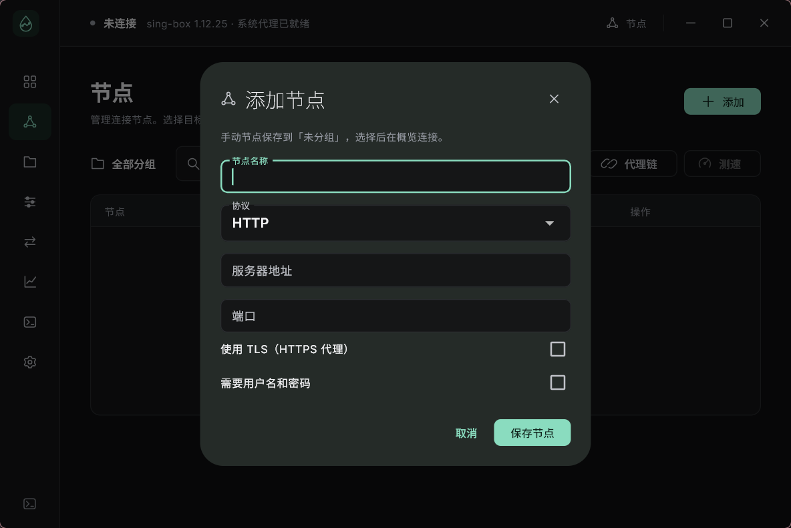
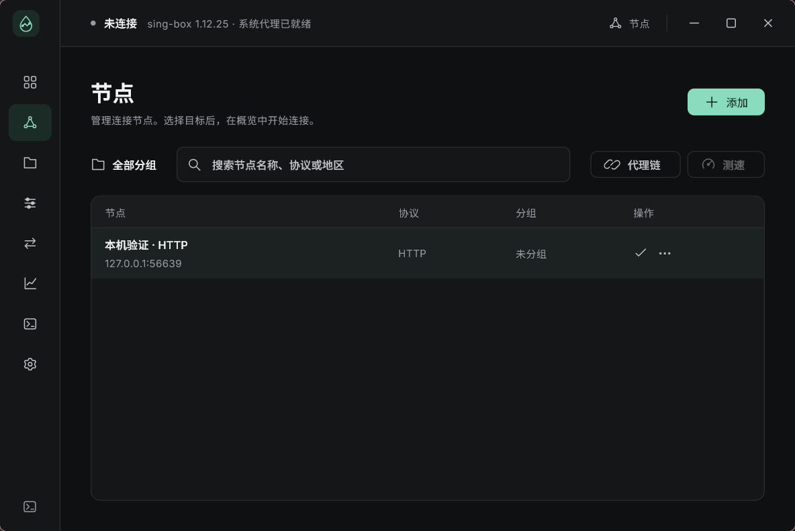
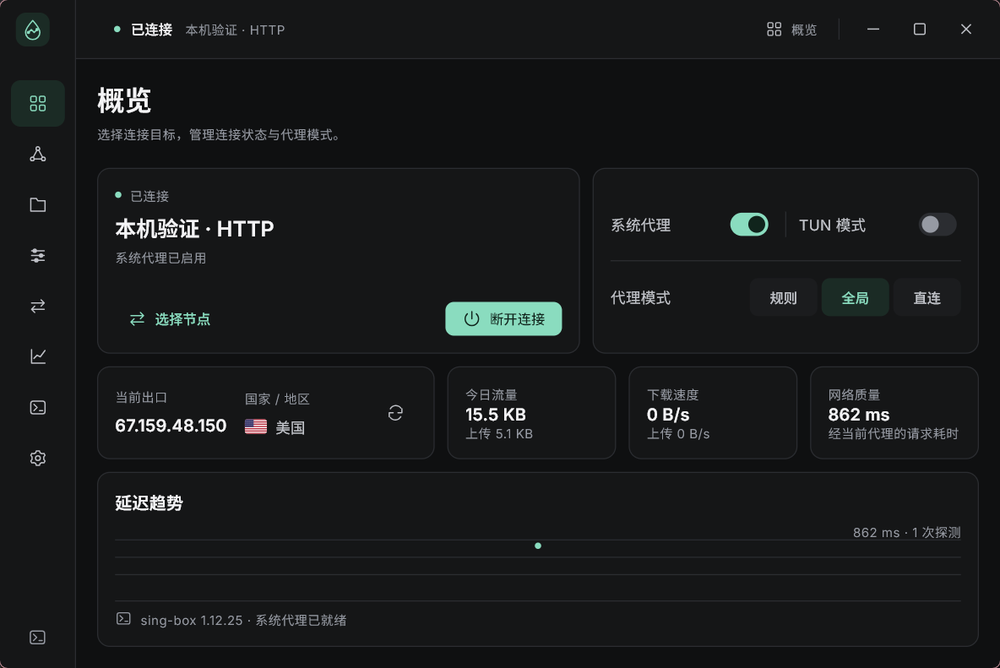
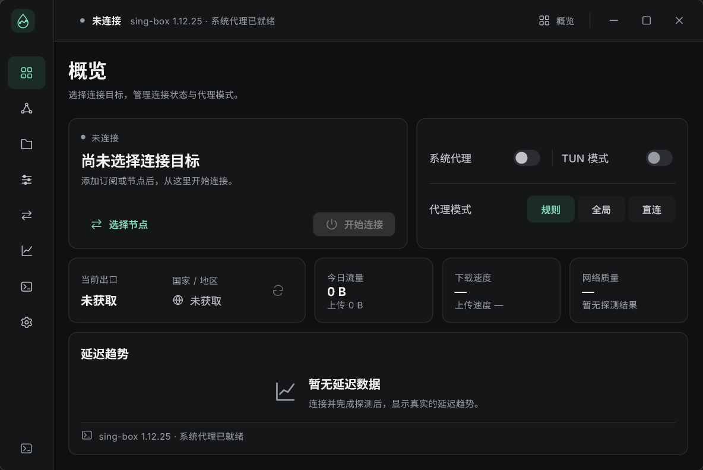

# Windows 真实连接验收

日期：2026-10-16。环境：Windows x64、Flutter 3.27.4 / Dart 3.6.2、Go 1.25.5、sing-box 1.12.25。

本文记录第一次 HTTP / SOCKS5 连接交付。后续协议与订阅能力、最新预览包见 [订阅和多协议验收](windows-subscriptions.md)，以下测试数量和构建摘要属于第一次交付。

## 当前可用流程

1. 「节点」→「添加」弹窗，手动填写 HTTP / SOCKS5；HTTP 可开启 TLS。
2. 按需填写认证，保存到 SQLite；用户名和密码经 Windows DPAPI 加密，绑定当前用户和节点 ID。
3. 选择节点；在「概览」设置代理模式、系统代理并开始连接。
4. 核心确认后才显示已连接。概览展示实际出口 IP、国家、速率、今日累计及真实延迟样本。
5. 断开连接或退出后恢复原系统代理；编辑、改选或删除节点不修改正在运行的节点快照。

桌面和移动布局仍按平台分开；节点仓库、会话模型和 Controller 共用。节点列表使用 ListView.builder。概览在可见且应用前台时才轮询，切页不停止实际连接。

## 已执行验证

| 检查 | 覆盖与证据 |
| --- | --- |
| Flutter 静态分析 | analyze 无问题 |
| Flutter 单元 / 组件测试 | 80 项；包含数据库重开、v1 迁移、凭据保护失败、并发修订、每日计数去重、取消、迟到回执、存储异常和两端布局 |
| Go 检查 | gofmt、go vet、go test；启用真实核心和系统代理检查 |
| HTTP / SOCKS5 | 实际 sing-box 转发至本机服务；HTTP Basic 和 SOCKS5 认证均实际验证 |
| 模式 | 全局请求经过上游，规则和直连模式的局域网请求绕过上游；运行时切换有 API 回读 |
| 系统代理 | 回读启用值，断开恢复原值；保留其他客户端后来修改的配置；只改旁路列表时仍恢复本应用的代理端点 |
| Windows UI 集成 | 弹窗添加 → 选择 → 连接 → 经注册表中的代理端口实际传输 → 真实字节计数 → 断开 |
| 并发通信 | 同时采样、探测和切换模式，不向正在 flush 的 stdin 写入；标题栏与概览状态一致 |
| 桌面启动 | 真正启动应用，读取宿主和核心状态；主题写入真实 SQLite，重新打开数据库确认后恢复原主题 |
| 公网探测 | 通过本机转发节点实际获得公网 IP、国家和 HTTPS 请求耗时；结果随当前网络变化 |
| 异常恢复 | 正常 disconnect、stdin EOF、强制终止核心、强制终止宿主四种场景均恢复注册表原值并关闭代理监听 |

本机 origin / 上游代理是测试夹具，运行的是实际 sing-box。没有用户提供的远端节点，本次没有宣称验证第三方服务商、移动隧道或所有协议。公网服务偶发失败已观察到：出口查询有三个来源、单请求 5 秒和整轮 20 秒期限，界面保留未获取状态与重试入口。

测试中曾修复旁路列表恢复测试的 Map 共享引用错误。测试残留已根据 Windows DefaultConnectionSettings / SavedLegacySettings 中一致的已存配置恢复，并重新验证；测试夹具不会写入用户节点库。

## 运行截图

这些截图来自实际 Windows 集成测试。连接示例使用内存数据库里的本机 HTTP 转发节点，测试结束会释放，不会留在用户数据库中。







Release 构建已实际启动，默认紧凑窗口内完整显示概览；未连接时没有样例出口或虚构流量。测试后已确认系统代理回到关闭状态，旁路列表与 Windows 保存配置一致，没有残留核心进程或待恢复记录。



构建和 SHA-256 记录见 [构建清单](windows-connection-build.json)。本地预览包位于 `build/RainLink-windows-x64-preview.zip`（41.9 MiB）；解压后运行 `RainLink/rainlink.exe`，保留同目录其他文件。ZIP 的 CRC 检查通过，包内宿主与本次构建一致，核心 SHA-256 与锁文件一致。

## 可复现命令

```powershell
./tools/dev.ps1 prepare

# 格式、静态检查与单元 / 组件测试；指定本机 Flutter SDK 时加 -FlutterRoot。
./tools/dev.ps1 check
./tools/dev.ps1 smoke

# 真实核心、认证和 Windows 用户级系统代理检查，测试会临时切换代理并恢复。
$env:RAINLINK_TEST_CORE_PATH = (Resolve-Path ./build/host/sing-box.exe).Path
$env:RAINLINK_TEST_SYSTEM_PROXY = '1'
Push-Location native/host
go test -v ./...
Pop-Location

python tools/verify_session.py          # 本机传输与四种恢复路径
python tools/verify_session.py --egress # 额外验证公网检测，依赖外部网络

Push-Location app
$env:RAINLINK_HOST_PATH = (Resolve-Path ../build/host/rainlink-host.exe).Path
flutter test integration_test/windows_connection_test.dart -d windows `
  "--dart-define=RAINLINK_HOST_PATH=$env:RAINLINK_HOST_PATH"
Pop-Location
./tools/dev.ps1 build
```

额外添加 `--dart-define=RAINLINK_TEST_PUBLIC_EGRESS=true` 开启公网断言，`--dart-define=RAINLINK_CAPTURE_UI=true` 用 Python/Pillow 抓取实际窗口截图。默认集成测试只依赖本机夹具。

详细命令输出位于本地忽略目录 `build/`：`unit-test-results.txt`、`analyze-session-results.txt`、`go-session-tests.txt`、`windows-connection-integration.txt`、`windows-desktop-smoke.txt`、`windows-session-verification.json`。发布目录为 `app/build/windows/x64/runner/Release`，运行时保留完整目录中的 DLL、data、宿主、核心和许可证。

## 尚未实现的范围

- VMess、Hysteria、TUIC、代理链、可编辑分流规则；订阅与三种新增协议已在后续交付接入。
- TUN、移动网络接管、macOS / Linux 真实连接和发布，托盘、自启动、安装器与自动更新。
- 当前规则模式只是局域网直连、其余走节点；DNS 使用系统解析器。Windows 系统代理仅覆盖遵循该设置的应用。
- 延迟表示当前路径的 HTTPS 请求耗时，包含 DNS / TLS；不是 ICMP Ping。不是将模拟分数包装为网络质量评分。
- 统计在采样时落盘，跨午夜的未采样增量归到采样当日；强制退出可能丢失最后未落盘部分，尚无完整历史统计与排行。
- HTTP TLS 已接线到核心配置；本次认证转发核验以本机普通 HTTP 和 SOCKS5 为准，未冒充已验证远端 HTTPS 代理证书。
- 当前提供设计稿已有的七个国家 SVG；其他国家使用地球图标。国家由出口检测返回，不能用节点名称推断。
