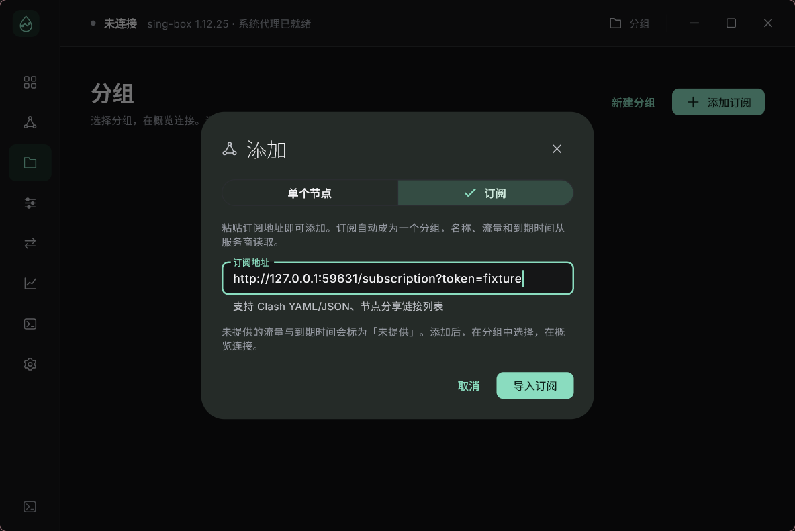
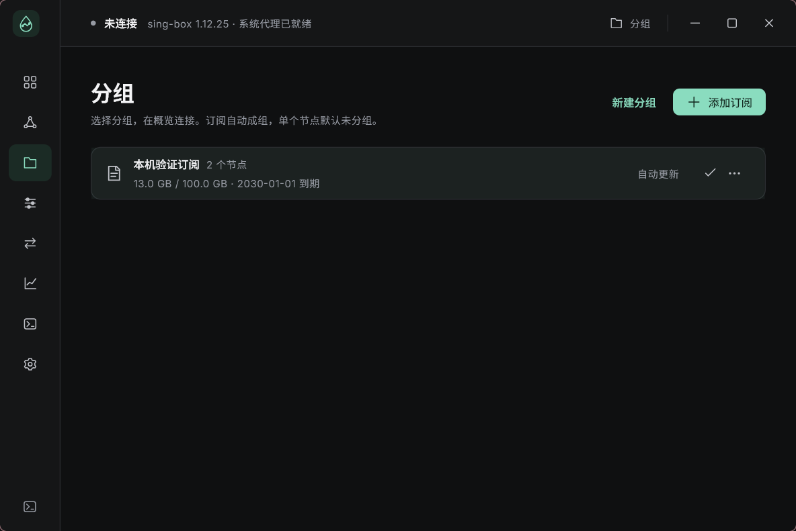
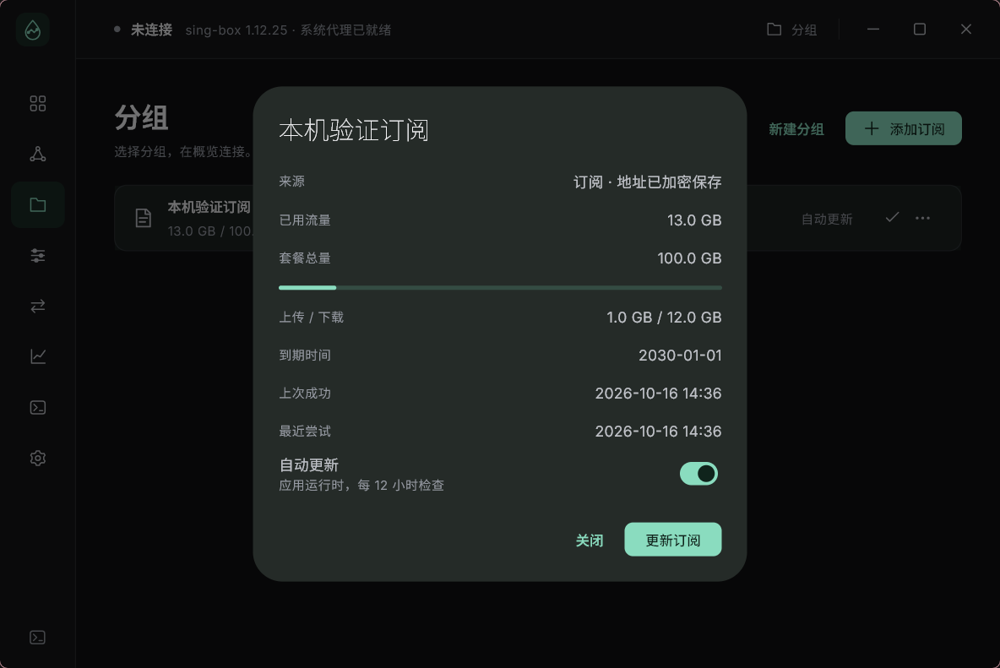
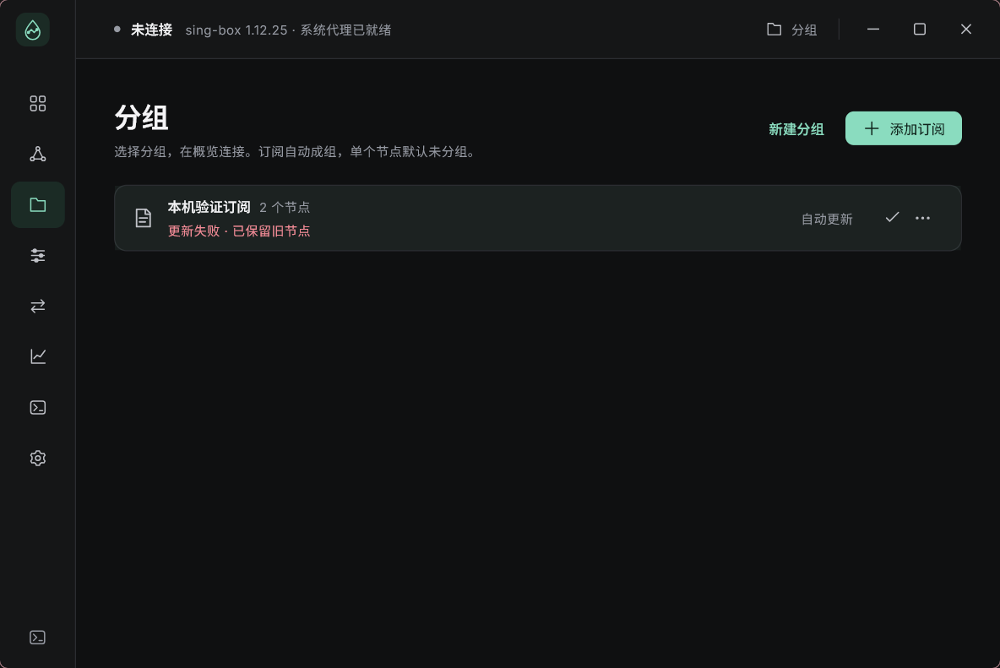
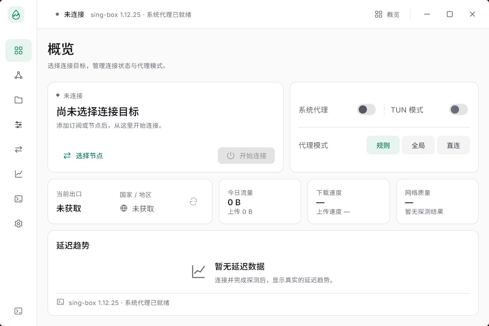

# Windows 订阅与多协议验收

日期：2026-10-16。Flutter 3.27.4 / Dart 3.6.2、Go 1.25.5、固定 sing-box 1.12.25。桌面和移动布局仍按平台独立，共用业务与数据层。

## 使用流程

1. 「节点」→「添加」：选择「单个节点」手动填写 HTTP、SOCKS5、Shadowsocks、VLESS 或 Trojan；默认保存在未分组。VLESS / Trojan 的高级选项提供 TCP、WebSocket、gRPC，以及 TLS、SNI、ALPN 和指纹；VLESS 还提供 Vision / Reality 参数。
2. 同一弹窗切换「订阅」，或「分组」→「添加订阅」：只填 URL，名称从 `profile-title`、文件名或服务器域名读取，无须分组名称。支持 Clash YAML/JSON `proxies`、明文 / Base64 分享链接列表；不执行远程规则、脚本或监听器设置。
3. 订阅自动成为分组；「⋯」可查看节点、用量、到期、更新时间、跳过数量、错误、自动更新开关，也可手动刷新、重命名或删除。未提供的流量 / 日期明确显示「未提供」。每次成功刷新以最新响应为准，避免保留已失效的旧用量。
4. 只有未分组的手动节点可以「移入分组」，可以选择已有分组或新建。订阅节点由订阅管理，不能逐个手动编辑、删除或移动。已经移入分组的手动节点仍可编辑、删除。
5. 点击分组恢复其上次有效选择，初次选择使用该组第一个节点；点击节点只改选择。在概览启动连接。更新订阅保留运行中的连接快照，重连后才应用新配置；有效选择保留，无效选择回退到组内有效节点。

自动更新只在应用运行时检查：默认 24 小时，服务商可通过 `profile-update-interval` 指定 1–168 小时。应用重新进入前台时检查逾期订阅；不包含退出应用后的后台任务。失败保留旧数据并记录尝试时间，按周期重试；手动更新随时可用。同一订阅不会并发更新，取消不提交部分数据。

## 已验证

| 检查 | 本轮证据 |
| --- | --- |
| Flutter 格式 / 静态检查 | dart format、analyze 无问题 |
| Flutter 单元 / 组件测试 | 109 项；新增订阅解析、重定向、超时、取消、响应大小、元数据、v2→v3 迁移、持久化、回滚、手动节点保护、选择记忆、同名多账户重排、并发删除、自动更新和两端弹窗 |
| 两端布局 | Windows 1040×720 / 640×640、Android 布局 393×852 / 320×740 的组件检查；URL-only 添加弹窗、紧凑分组、详情及订阅节点菜单无溢出；这是布局测试，不是移动网络接管验证 |
| 实际加密转发 | Go 启动独立 sing-box 入站作为本地上游，实际传送 HTTP 负载：SS AEAD、SS 2022、VLESS TCP、VLESS WebSocket/TLS、VLESS gRPC/TLS、Trojan TLS、Trojan WebSocket/TLS |
| 认证 / TLS | 各场景错误认证均未到达目标服务；Trojan 自签测试证书仅在显式跳过验证后成功，默认校验拒绝它；没有使用生产凭据 |
| Reality / Vision | 使用有效 X25519 公钥通过真实核心 `check`；错误 Short ID / Flow 被拒绝。本轮没有验证外部 Reality 服务器握手 |
| Windows 订阅集成 | 实际窗口填 URL → 本地 HTTP 订阅 → DPAPI 加密 URL / 节点秘密 → 自动分组 → 点选分组 → SS / VLESS 真实转发；刷新保留当前会话与选择，HTTP 503 保留两条旧节点并显示错误 |
| 向后兼容 | 原手动 HTTP 弹窗 → 真实系统代理 → 实际转发 → 断开恢复的 Windows 集成再次通过 |
| 系统恢复 | 正常断开、stdin EOF、核心被终止、宿主被终止，四种场景均实际传输并确认精确恢复原代理、关闭监听器；Go 的真实系统代理回读和其他客户端修改保护测试再次通过 |

订阅服务器、流量额度、到期日期和远端代理均为本地测试夹具。截图中的 13 GB / 100 GB 和 2030-01-01 来自夹具响应头，用于验证解析和显示；不代表真实服务商账户。业务与凭据存储使用内存数据库，测试后销毁，未把样例节点加入用户数据库。

### 实际 Windows 窗口









实际 Release 启动保持用户已保存的主题与紧凑窗口，没有注入样例节点。



## 边界与实现

订阅 HTTP 请求限 20 秒、最多 5 次重定向、8 MiB 解压后正文、2000 个节点，不允许 HTTPS 降到 HTTP。订阅地址最多 4096 个规范化字符，不接受 URL 用户名 / 密码。网络与解析错误不回显带令牌的 URL 或响应正文。节点密码 / UUID 和订阅地址经 Windows DPAPI 绑定用户和记录 ID 保存，URL 去重仅使用摘要。导入 / 刷新在完整获取、校验和加密后，以单一数据库事务提交。

刷新只替换本订阅管理的节点，保留手动移入的节点；删除订阅会把手动节点移回未分组。名称 / 参数未变时不提高节点修订；节点改名和密码更换有稳定身份匹配，同名同地址的多账户优先匹配凭据，避免服务商重排后交换选中账户。凭据只在内存比较，不将其摘要写入 sourceKey。长请求返回时校验分组修订，已删除分组不会被重新创建。

尚未实现 VMess、Hysteria、TUIC、SS 插件、WebSocket Early Data、额外自定义 WebSocket 头、远程配置中的链式 / 多路复用扩展和任意 sing-box 配置导入。包含这些选项的节点会被计入跳过数量；全无有效节点则保留旧数据并失败。可编辑规则、代理链、TUN、完整历史排行、托盘和应用自动升级也仍属后续工作。macOS / Linux / Android / iOS 真实会话和安全存储尚未接入。

## 复现与交付

```powershell
./tools/dev.ps1 prepare
./tools/dev.ps1 check -FlutterRoot '你的 Flutter SDK'

$env:RAINLINK_TEST_CORE_PATH = (Resolve-Path ./build/host/sing-box.exe).Path
$env:RAINLINK_TEST_SYSTEM_PROXY = '1'
Push-Location native/host
go test -v ./...
go vet ./...
Pop-Location
python tools/verify_session.py

Push-Location app
$subscriptionHost = (Resolve-Path ../build/host/rainlink-host.exe).Path
flutter test --no-pub integration_test/windows_subscription_test.dart -d windows "--dart-define=RAINLINK_HOST_PATH=$subscriptionHost"
flutter test --no-pub integration_test/windows_connection_test.dart -d windows "--dart-define=RAINLINK_HOST_PATH=$subscriptionHost"
flutter test --no-pub integration_test/desktop_smoke_test.dart -d windows "--dart-define=RAINLINK_HOST_PATH=$subscriptionHost"
Pop-Location
./tools/dev.ps1 build -FlutterRoot '你的 Flutter SDK'
```

窗口截图额外使用 `--dart-define=RAINLINK_CAPTURE_UI=true`。本轮命令输出位于忽略目录 `build/subscription-*.txt`，恢复证据为 `build/subscription-session-recovery.json`（逐行 JSON）。完整预览包为 `build/RainLink-windows-x64-subscriptions-preview.zip`，解压后运行 `RainLink/rainlink.exe` 并保留同目录文件。平台、检查结果、包与二进制 SHA-256 见 [构建清单](windows-subscriptions-build.json)。

调试测试和 Release 构建需串行执行，避免共享的 Flutter ephemeral 引擎混入错误构建。构建脚本会比对发布 DLL 与 SDK `windows-x64-release` 引擎的 SHA-256，错误时拒绝交付；本轮在重新串行构建后已通过比对并实际启动，启动日志没有引擎错误。
